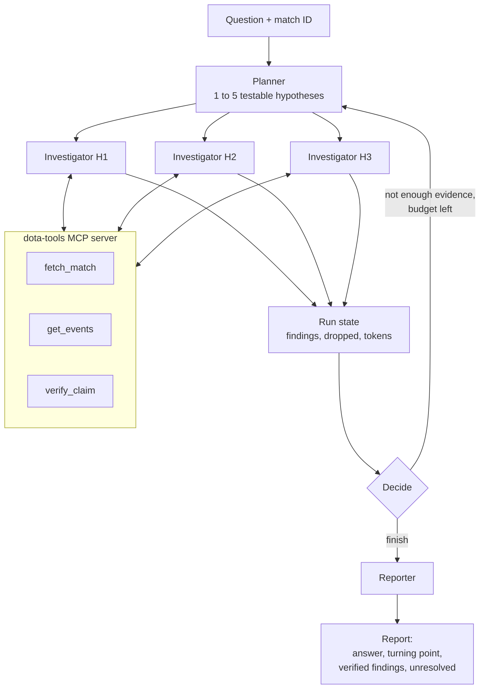

# why_proebali_dota2

**An AI agent that works out why a Dota 2 match was lost.**

Give it a finished match and a question ("What were the key mistakes?"). It plans hypotheses, investigates each one in parallel with tools, **checks every number it cites against the real match data**, and writes a short report with a turning point and the evidence behind each finding.

This project is a showcase of AI agent engineering: the **same agent architecture built twice**, once **from scratch** on the Anthropic API and once with **LangGraph**, so the two approaches can be compared on identical tasks. Evaluation with **RAGAS** is planned.

## Status

| Piece | State |
|-------|-------|
| Baseline (single LLM call, no tools) | Done |
| **From-scratch agent** (planner, parallel investigators, reporter, orchestrator) | Done and working |
| LangGraph agent (same architecture, library version) | Planned |
| RAGAS evaluation across both systems | Planned |

## How the from-scratch agent works



1. **Planner** reads a compact match digest and proposes 3 independent, falsifiable hypotheses (max 5), each a single sentence naming one cause.
2. **Investigators** run in parallel (`asyncio.gather`), one per hypothesis. Each is a tool-calling loop (up to 8 tool calls) that explores the match through MCP tools and ends by calling `submit_finding`.
3. **Verification gate.** Before a finding is accepted, every piece of evidence in it is re-checked by the deterministic `verify_claim` tool. If a number or timestamp is wrong, the model gets the *actual* value back and gets a bounded retry. A finding that cannot be verified is dropped, never reported.
4. **Orchestrator decision.** After each round a plain-Python rule decides to `finish` or `replan` (asking the planner for new hypotheses, excluding ones already tried), based on evidence count, an iteration limit, and a token budget.
5. **Reporter** turns the verified findings into a 2-4 sentence answer, an optional turning point (only if a finding backs it), and a list of what remains unresolved.

### Design highlights

- **No LLM-as-judge for facts.** Evidence is typed (`stat`, `timeline`, `event`) and checked against OpenDota data in code. Verification messages are written for the model to read, e.g. *"gold_adv at 1320s is -50352, not -30596"*, so retries fix the fact, not just the format.
- **Strict structured output.** Pydantic schemas with cross-field validators (each evidence kind requires and forbids specific fields). Validation errors are fed back to the model for a retry. One validator exists because tool-call markup leaked into a `claim` string in a real run.
- **MCP for tools and prompts.** A stdio MCP server (`dota-tools`) exposes three tools and the planner / investigator / reporter prompts. The agent talks to it through a small hand-written MCP bridge, the from-scratch counterpart of a library adapter.
- **Crash-safe runs.** The orchestrator writes an atomic checkpoint after every planning step, so an interrupted run resumes with `--resume <run_id>`.
- **Budgets everywhere.** Max tool calls per investigator, max retries, max iterations, and a token cap for the whole run.
- **Cost and reproducibility.** Every LLM response is cached on disk (keyed by a hash of the full request), a spend ledger records real cost per call, and OpenDota matches are cached locally.
- **Observability.** Every LLM call, investigator, and run is traced in [Langfuse](https://langfuse.com/) with token usage and cost.
- **Testable without an API key.** The LLM is injected, and tests drive the planner, investigators, orchestrator, and reporter with scripted fake LLMs (`tests/fakes.py`).

## The three systems

| | Baseline | From scratch | LangGraph |
|---|---|---|---|
| Approach | One call, forced `submit_report` tool | Planner, parallel investigators, verifier, reporter | Same architecture as a graph |
| Tools | None (digest in the prompt) | MCP: `fetch_match`, `get_events`, `verify_claim` | Same tools |
| Evidence checked in code | Schema only | Every evidence item | Same |
| Replanning, budgets, resume | No | Yes | Yes |
| Status | Done | Done | Planned |

The baseline and both agent versions share the same model, prompt settings, schemas, tools, and match digest, so differences in results come from the architecture and not from the setup.

## Data

- **Source:** [OpenDota API](https://docs.opendota.com/) (free tier, requests are rate-limited in code and cached on disk). Only **parsed** matches work, since timelines and event logs come from the replay parse.
- **Match digest:** a compact text summary (about 2-3k tokens) with the result, per-player stats and final items, per-minute gold and XP advantage, objectives, and teamfight deaths per team. It is a whitelist, so fields like OpenDota's own `throw` / `loss` scores can never leak to the model.
- **Evaluation set:** `data/matches.json` holds 10 matches chosen by criteria fixed up front (Turbo mode, 18-35 minutes, no leavers, no pro matches, at least 4 comebacks) so the selection isn't tuned to any model's output. `scripts/pick_matches.py` regenerates it.

## Getting started

**Requirements:** Python 3.12, an [Anthropic API key](https://console.anthropic.com/), and optionally a Langfuse project for tracing.

```bash
git clone https://github.com/McCarryster/why_proebali_dota2.git
cd why_proebali_dota2

python -m venv .venv
source .venv/bin/activate          # Windows: .venv\Scripts\activate

pip install -e ".[dev]"
```

Create a `.env` file in the repo root:

```env
ANTHROPIC_API_KEY=your-anthropic-key

# Optional: Langfuse tracing
LANGFUSE_PUBLIC_KEY=your-public-key
LANGFUSE_SECRET_KEY=your-secret-key
LANGFUSE_HOST=https://cloud.langfuse.com
```

## Usage

**Run the from-scratch agent** on a match from `data/matches.json`:

```bash
python scripts/run_orchestrator.py 9041878637
python scripts/run_orchestrator.py 9041878637 --question "Why did Radiant lose the lead?"
python scripts/run_orchestrator.py 9041878637 --resume <run_id>   # continue an interrupted run
```

It prints a run ID, a Langfuse trace URL, and the final report as JSON (shape shown, values are illustrative):

```json
{
  "answer": "...",
  "turning_point_s": 641,
  "unresolved": ["..."],
  "key_findings": [
    {
      "claim": "...",
      "verdict": "supported",
      "severity": "decisive",
      "evidence": [{ "kind": "event", "player": "Hero (Team)", "event_type": "deaths", "time_s": 372 }]
    }
  ]
}
```

**Run the baseline** for comparison:

```bash
python scripts/run_baseline.py
```

**Run a single stage** while developing:

```bash
python scripts/show_digest.py 9041878637      # the exact text the models see
python scripts/run_planner.py 9041878637      # planner only
python scripts/run_investigator.py 9041878637 --hypothesis "..."   # one investigator, one hypothesis
```

## Tests

```bash
pytest
```

The suite covers schemas, deterministic verification, event extraction, the tool registry, MCP tool bridging, planner, investigator, reporter, orchestrator, run state, and checkpointing. LLM behaviour is simulated with scripted fakes, so no API key or network is needed.

## Project structure

```
.
├── coach/
│   ├── llm.py                     # Anthropic wrapper: disk cache, cost ledger, Langfuse generations
│   ├── prompt.py                  # Baseline system prompt
│   ├── schemas.py                 # Evidence, Finding, Report, Plan (Pydantic + validators)
│   ├── dota/                      # OpenDota client, match digest, event extraction, verification
│   ├── tools/                     # Tool logic (core.py) + hand-wired registry (handwired.py)
│   ├── mcp_server/server.py       # MCP server: dota-tools + planner/investigator/reporter prompts
│   └── systems/
│       ├── baseline.py            # Single-call baseline
│       └── scratch/               # planner, investigator, reporter, orchestrator,
│                                  # state, checkpoint, MCP bridge
├── scripts/                       # Runnable entry points and data exploration
├── tests/                         # pytest suite with fake LLMs
└── data/matches.json              # 10 selected evaluation matches
```

## Roadmap

- [ ] LangGraph implementation of the same planner / investigator / verifier / reporter architecture
- [ ] RAGAS evaluation of both systems on the 10-match set
- [ ] Side-by-side comparison: quality, cost, latency, and lines of code, from-scratch vs LangGraph

## Tech stack

Python 3.12, [Anthropic API](https://docs.anthropic.com/) (Claude Haiku), [Model Context Protocol](https://modelcontextprotocol.io/), Pydantic, asyncio, Langfuse, pytest, OpenDota. LangGraph and RAGAS are planned.
